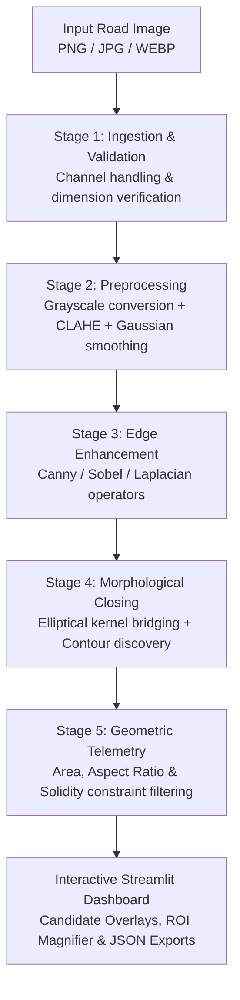
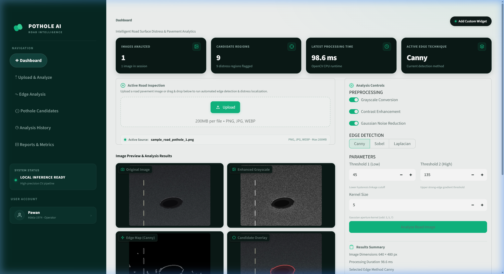
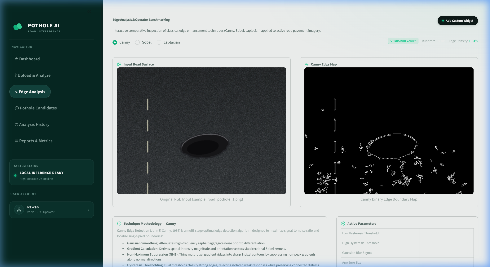
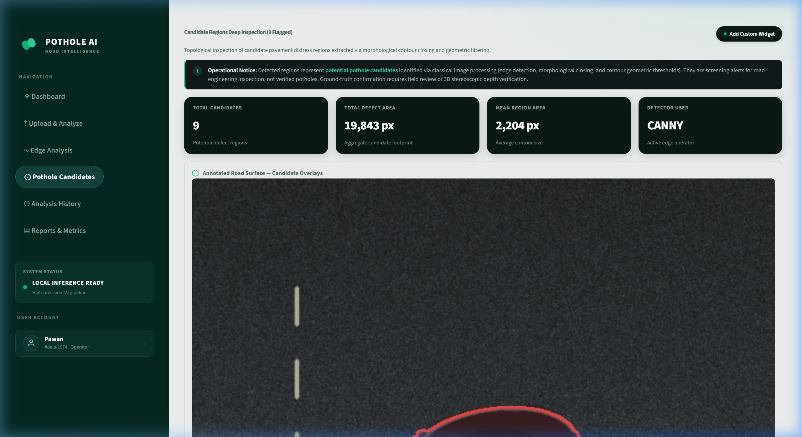

# POTHOLE AI — Road Pothole Detection Using Edge Enhancement Techniques

**Academic Project Title:** *Apply Edge Enhancement Techniques to Highlight Potholes in Road Images*

> **An interpretable classical computer vision application for roadway pavement distress analysis and candidate cavity screening using multi-scale edge enhancement and morphological filtering.**

[](https://www.python.org/)
[](https://streamlit.io/)
[](https://opencv.org/)
[](https://pytest.org/)
[](https://github.com/PAWANKRISHNA28/POTHOLE-ai)
[](#-academic-project-credits)

---

## 📌 Project Overview

**POTHOLE AI** is an academic computer vision project and interactive inspection dashboard developed to analyze road surface imagery, suppress pavement texture noise, and isolate candidate pothole distress boundaries using classical image processing techniques.

Rather than operating as an uninterpretable deep neural network requiring dedicated GPU acceleration and extensive labeled training sets, this project implements and evaluates fundamental mathematical edge operators (**Canny**, **Sobel**, and **Laplacian**). When combined with **Contrast Limited Adaptive Histogram Equalization (CLAHE)**, elliptical morphological closing, and geometric contour constraints, the application functions as a local-first **Region of Interest (ROI) candidate screening tool** to assist roadway inspectors and infrastructure evaluation teams.

> [!IMPORTANT]
> **Traditional Computer Vision Scope & Candidate Interpretation**: This project is built entirely on classical digital image processing algorithms that measure pixel luminance transitions and spatial gradient discontinuities. Detected edge boundaries and highlighted contours represent **candidate distress hypotheses**, not guaranteed physical potholes. Non-cavity surface artifacts (e.g., cast shadows, painted lane stripes, dark tire marks, surface aggregate variations, and standing water) may generate strong gradient responses. The system is designed for human-in-the-loop triage, review, and preliminary screening.

---

## 🛑 Problem Statement

Potholes and asphalt surface depressions represent major sources of vehicular structural damage, traffic delays, and road accidents globally. Existing road inspection approaches face distinct operational trade-offs:

1. **Manual Visual Surveys**: Labor-intensive, slow, subjective, and hazardous for field personnel on active high-speed roadways.
2. **Specialized Inspection Vehicles**: High-precision laser profilometer and LiDAR inspection vehicles require capital investments ($100,000+) beyond the reach of many local public works departments.
3. **Pure Deep Learning Classifiers**: Demand annotated training data, exhibit susceptibility to environmental domain shifts (e.g., changes in lighting, wet asphalt), and operate with limited mathematical explainability on CPU-only edge hardware.

There is a practical need for an **interpretable, CPU-efficient, edge-deployable computer vision solution** capable of isolating pavement distress boundaries deterministically on standard road camera imagery.

---

## 🎯 Objectives

1. **Evaluate Classical Edge Operators**: Compare the localization precision, noise susceptibility, and runtime behavior of Canny, Sobel, and Laplacian operators on roadway asphalt.
2. **Normalize Illumination Variance**: Implement adaptive contrast enhancement (CLAHE) and Gaussian filtering to mitigate variable shadows and high-frequency aggregate gravel noise.
3. **Bridge Fragmented Boundaries**: Apply morphological closing kernels to connect disjoint edge segments surrounding physical depressions.
4. **Filter Non-Distress Artifacts**: Apply transparent geometric rules (area bounds, aspect ratio limits, convex hull solidity) to reject linear lane markings and uniform aggregate textures.
5. **Interactive Inspection Interface**: Provide a professional Streamlit dashboard for real-time parameter tuning, side-by-side operator benchmarking, ROI magnification, and structured report exports.

---

## 🌟 Confirmed Features

All features listed below are verified in the codebase (`src/` and `app.py`):

* **Multi-Format Image Ingestion & Validation** (`src/preprocessing.py`):
  * Supported formats: `PNG`, `JPG`, `JPEG`, `WEBP`.
  * Verified channel handling: 1-channel Grayscale (expanded to 3-channel RGB), 3-channel RGB/BGR, and 4-channel RGBA (alpha blended to RGB).
  * Dimension boundary validation ($16 \times 16$ px minimum up to $8192 \times 8192$ px maximum) to prevent spatial convolution underflow or memory exhaustion.
* **Adaptive Preprocessing Pipeline** (`src/preprocessing.py`):
  * Grayscale conversion supporting weighted luminance ($Y = 0.299R + 0.587G + 0.114B$), average mean, and green channel extraction.
  * Contrast optimization via CLAHE (configurable clip limit and tile grid), Global Histogram Equalization, and Percentile Contrast Stretching.
  * Noise reduction via Gaussian smoothing with configurable aperture kernels.
* **Edge Detection Studio** (`src/edge_detection.py`):
  * **Canny**: Non-maximum suppression and dual-threshold hysteresis with automatic ascending threshold validation.
  * **Sobel**: Directional spatial derivatives ($G_x$ for vertical features, $G_y$ for horizontal features) and combined gradient magnitude.
  * **Laplacian**: Second-order isotropic spatial derivative operator ($\nabla^2 f$).
  * Quantitative edge density calculation (percentage of active edge pixels relative to total image area).
* **Morphological Candidate Extraction** (`src/pothole_detection.py`):
  * Elliptical structuring element closing (`cv2.morphologyEx` with `MORPH_CLOSE`) to bridge micro-gaps across detected edge perimeters.
  * Topological contour retrieval (`cv2.findContours` using `RETR_EXTERNAL` and `CHAIN_APPROX_SIMPLE`).
* **Geometric Telemetry & Filtering** (`src/pothole_detection.py`):
  * Per-candidate bounding box coordinates $(x, y, w, h)$, contour area, perimeter, aspect ratio, and convex hull solidity.
  * Minimum and maximum area constraints, aspect ratio bounds, and solidity cutoffs.
* **Candidate HUD & Interactive ROI Magnifier** (`src/pothole_detection.py`, `app.py`):
  * Color-coded bounding box overlays rendered directly onto the road image.
  * Per-candidate visual crop inspector with high-resolution magnification.
* **Exportable Research Artifacts** (`src/evaluation.py`, `app.py`):
  * One-click download of processed candidate overlay PNGs.
  * Standardized research JSON reports capturing complete pipeline parameters and detected candidate telemetry.
  * Session-based history log with CSV export capability (`pothole_ai_history.csv`).
* **Built-in Benchmark Scenarios** (`data/sample_images/`, `src/image_utils.py`):
  * Selectable asphalt test scenarios: *Single Deep Cavity*, *Multiple Clusters*, and *Wet Road Cavity* (with algorithmic procedural generation fallback).
* **6 Cohesive Navigation Views** (`app.py`):
  * Fully unified multi-view navigation covering Dashboard, Ingestion, Edge Comparison, Candidate Telemetry, Session History, and Exportable Reports.

---

## 🛠️ Technology Stack

| Category | Technology | Purpose in Project |
| :--- | :--- | :--- |
| **Language** | Python (3.10+) | Core programming language for algorithm implementation |
| **Computer Vision** | `opencv-python-headless` (>= 4.8.0) | Convolutions, spatial derivatives, morphology, contour discovery |
| **Array Computing** | `numpy` (>= 1.24.0) | Multidimensional matrix manipulations, masking, and intensity math |
| **Data Processing** | `pandas` (>= 2.0.0) | Telemetry structuring, candidate dataframes, and history logs |
| **Application Layer** | `streamlit` (>= 1.35.0) | Reactive user interface, parameter controls, and multi-page routing |
| **Imaging & Graphics**| `matplotlib` (>= 3.7.0), `Pillow` (>= 10.0.0) | Intensity distribution histograms, montages, and byte encoding |
| **Automated Testing** | `pytest` (>= 8.0.0) | Automated unit testing for pipeline edge cases and algorithms |

---

## 🔬 System Architecture & Processing Workflow

The computational pipeline executes across 5 sequential stages:



### Computational Stages:

1. **Stage 1 — Ingestion & Validation**: Verifies file integrity, decodes byte streams, handles color channel variations, and guards against invalid image dimensions.
2. **Stage 2 — Preprocessing & Normalization**: Converts input imagery to grayscale ($Y = 0.299R + 0.587G + 0.114B$), equalizes localized contrast variations using CLAHE, and applies Gaussian smoothing ($G_\sigma$) to attenuate sensor noise.
3. **Stage 3 — Edge Enhancement**: Computes spatial gradients to highlight physical boundary discontinuities.
4. **Stage 4 — Morphological Processing**: Applies morphological closing ($A \bullet B = (A \oplus B) \ominus B$) with an elliptical structuring element to bridge micro-gaps, followed by external contour extraction.
5. **Stage 5 — Geometric Filtering & Telemetry**: Filters candidate contours against geometric thresholds to eliminate false positives and compiles telemetry reports.

---

## 📊 Canny vs. Sobel vs. Laplacian Comparison

| Evaluation Metric | Canny Edge Detector | Sobel Gradient Operator | Laplacian Operator |
| :--- | :--- | :--- | :--- |
| **Mathematical Formulation** | Directional gradient + NMS + Hysteresis | 1st-order partial spatial derivatives ($G_x, G_y$) | 2nd-order isotropic spatial derivative ($\nabla^2 f$) |
| **Derivative Order** | First-order with thinning | First-order discrete | Second-order isotropic |
| **Separable Kernels** | Yes (Gaussian smoothing + Sobel gradients) | Yes ($3 \times 3$ horizontal & vertical kernels) | Typically single $3 \times 3$ or $5 \times 5$ kernel |
| **Noise Sensitivity** | Low (integral Gaussian pre-filter) | Moderate (some smoothing via kernel weights) | High (extremely sensitive to asphalt texture noise) |
| **Edge Continuity** | High (hysteresis bridges weak-to-strong edges)| Moderate (threshold-dependent) | Low (fragmented zero-crossings) |
| **Edge Thickness** | Single-pixel width (via NMS) | Multi-pixel diffuse boundaries | Multi-pixel / double-edge transitions |
| **Computational Cost** | Moderate (multi-stage pipeline) | Very Low (two direct $3 \times 3$ convolutions) | Lowest (single spatial convolution) |
| **Roadway Application** | **Optimal** for distinct cavity perimeter isolation | Useful for detecting linear fissures ($G_x$ vs $G_y$) | Useful for rapid localized texture change indicators |
| **Asphalt Caveats** | Requires threshold tuning across varying road types | Produces wide boundaries requiring extra thinning | Amplifies aggregate gravel noise without heavy smoothing |

---

## 🖼️ Screenshot Gallery

The screenshots below illustrate key application interfaces captured from the running Streamlit dashboard:

### 1. Main Inspection Dashboard
*Unified workspace displaying real-time metrics, active road image upload, 2×2 image inspection grid, and reactive analysis controls.*



### 2. Tri-Detector Edge Analysis Studio
*Comparative benchmarking studio displaying Canny, Sobel, and Laplacian edge maps, directional gradient components ($G_x, G_y$), and edge density metrics.*



### 3. Pothole Candidate Extraction & ROI Magnifier
*Contour detection overlay, telemetry table with area and solidity parameters, and high-resolution candidate crop inspection.*



> [!NOTE]
> **Canonical Screenshot Path**: All interface screenshots are stored in `docs/screenshots/` and referenced via relative Markdown paths. To refresh or update these images, capture the respective view from your local running instance and save them to `docs/screenshots/dashboard.png`, `docs/screenshots/edge-comparison.png`, and `docs/screenshots/candidate-detection.png`.

---

## 🚀 Installation & Launch Guide (Windows)

### 1. Prerequisites
* **Operating System**: Windows 10 or 11 (also compatible with macOS and Linux).
* **Python**: Python 3.10, 3.11, or 3.12 (Python 3.14 verified).
* **Git**: Installed and accessible from your terminal.

### 2. Clone the Repository
Open PowerShell and clone the project:
```powershell
git clone https://github.com/PAWANKRISHNA28/POTHOLE-ai.git
cd POTHOLE-ai
```

### 3. Set Up Virtual Environment
Create and activate an isolated Python virtual environment:
```powershell
python -m venv .venv
.\.venv\Scripts\Activate.ps1
```
*(If PowerShell restricts script execution, run: `Set-ExecutionPolicy -Scope Process -ExecutionPolicy Bypass`)*

### 4. Install Dependencies
```powershell
pip install -r requirements.txt
```

### 5. Launch the Dashboard
Run the Streamlit application from the root directory:
```powershell
python -m streamlit run app.py
```

The application will launch and display local network addresses:
```
Local URL: http://localhost:8501
Network URL: http://192.168.x.x:8501
```
Open **`http://localhost:8501`** in any modern web browser.

> [!TIP]
> **Repository Structure Note**: The root [`app.py`](app.py) is the primary and authoritative application entry point. A nested `Road-Pothole-Detection/` subfolder is preserved in the repository for backwards compatibility with nested workspaces; both contain identical core application logic.

---

## 📖 Usage Guide

The application features 6 focused navigation views accessible from the sidebar:

1. **`◈  Dashboard`**: The primary operational screen. Upload a road pavement photo (or click *Load A/B/C* under *Test Scenarios*), adjust preprocessing toggles and edge parameters in real time, inspect the 2×2 preview grid, and download annotated overlays or JSON reports.
2. **`⇡  Upload & Analyze`**: A dedicated multi-tab view for step-by-step image ingestion, individual full-resolution view of each pipeline step, and parameter configuration.
3. **`∿  Edge Analysis`**: Multi-detector benchmark laboratory. Compare Canny, Sobel, and Laplacian side-by-side, view directional gradient decompositions ($G_x$ and $G_y$), and review calculated edge pixel densities.
4. **`⊙  Pothole Candidates`**: Deep-dive candidate inspection. View filtered bounding boxes, inspect geometric properties (area, aspect ratio, solidity), and zoom into individual candidate crops.
5. **`◷  Analysis History`**: An audit log tracking images analyzed during the current browser session, including detector selection, candidate counts, and execution runtimes with CSV export.
6. **`▤  Reports & Metrics`**: Summary statistics, comparative telemetry matrices, and export buttons for annotated images, pipeline montages, and JSON research reports.

---

## 🧪 Testing & Quality Assurance

Automated unit tests validate algorithm correctness, edge-case resilience, and report schemas using `pytest`:

```powershell
pytest -v
```

### Test Suite Structure

```
tests/test_preprocessing.py .............. [8 unit tests]
tests/test_edge_detection.py ............. [7 unit tests]
tests/test_pothole_detection.py .......... [6 unit tests]
tests/test_image_utils_and_evaluation.py . [6 unit tests]
```

* **`tests/test_preprocessing.py`**: Verifies input validation (bytes, PIL images, NumPy arrays), invalid format rejections, dimension bounds, grayscale conversions, CLAHE adjustments, and Gaussian noise filtering.
* **`tests/test_edge_detection.py`**: Validates Canny hysteresis (including inverted threshold recovery), Sobel directional components, Laplacian convolutions, edge density calculations, and invalid kernel size fallbacks.
* **`tests/test_pothole_detection.py`**: Validates morphological closing, contour extraction, bounding box calculations, candidate overlay drawing, and empty image handling.
* **`tests/test_image_utils_and_evaluation.py`**: Validates synthetic road sample generation, montage composition, JSON serialization, and telemetry formatting.

---

## 📂 Project Directory Structure

```
POTHOLE-ai/
├── app.py                      # Primary Streamlit application entry point
├── requirements.txt            # Python dependencies (OpenCV, Streamlit, NumPy, etc.)
├── README.md                   # Repository documentation & guide
├── .gitignore                  # Git ignore rules for virtual environments & caches
├── assets/
│   ├── logo.png                # Application branding logo
│   └── style.css               # Dark charcoal (#11191B) & emerald (#32D6A0) styling
├── data/
│   ├── input/                  # Staging folder for image uploads
│   └── sample_images/          # Benchmark road test samples
├── docs/                       # Project documentation suite
│   ├── demo_checklist.md       # Pre-flight presentation checklist
│   ├── demo_script.md          # Live walkthrough script
│   ├── methodology.md          # Detailed 12-step computer vision pipeline
│   ├── presentation_outline.md # 10-slide presentation deck plan
│   ├── project_report.md       # Comprehensive academic project report
│   ├── results.md              # Experimental benchmarks & evaluation template
│   ├── viva_questions.md       # Technical viva preparation guide
│   └── screenshots/            # Canonical interface screenshots
│       ├── dashboard.png
│       ├── edge-comparison.png
│       └── candidate-detection.png
├── outputs/                    # Export directory for processed artifacts
├── src/                        # Core computer vision engine modules
│   ├── __init__.py             # Module exports
│   ├── edge_detection.py       # Canny, Sobel, Laplacian implementations
│   ├── evaluation.py           # Metric calculations & JSON report builder
│   ├── image_utils.py          # IO helpers, montages & synthetic road generator
│   ├── pothole_detection.py    # Morphology & candidate contour extraction
│   └── preprocessing.py        # Grayscale, CLAHE contrast & Gaussian blur
├── tests/                      # Automated unit test suite (27 tests)
│   ├── __init__.py
│   ├── test_edge_detection.py
│   ├── test_image_utils_and_evaluation.py
│   ├── test_pothole_detection.py
│   └── test_preprocessing.py
└── Road-Pothole-Detection/     # Preserved nested subproject directory
```

---

## ⚠️ Limitations & Operational Scope

1. **Distress Candidates vs. Physical Potholes**: Classical edge detection evaluates spatial intensity gradients. It does **not** perform semantic classification. Non-pothole roadway features such as cast shadows (trees, utility poles), dark oil stains, tire skid marks, painted lane markings, and asphalt expansion seams can produce strong gradient responses and be flagged as candidate regions.
2. **Illumination Dependence**: Parameter thresholds calibrated for bright, direct sunlight may require adjustment for overcast, twilight, or shadowed conditions.
3. **Absence of 3D Depth**: Standard 2D monocular images lack depth data; physical cavity volume and depth cannot be measured without stereo cameras or LiDAR instrumentation.
4. **Session Storage Scope**: Analysis history is maintained in Streamlit session memory and resets when the browser session is closed or reloaded.

---

## 🔮 Future Improvements

1. **Two-Stage Cascaded Detection**: Use classical edge enhancement as a lightweight, high-recall ROI pre-filter, followed by a lightweight neural classifier (e.g., MobileNet or YOLO) to semantically verify each candidate crop.
2. **Stereo Disparity & 3D Reconstruction**: Integrate calibrated dual-camera setups to compute disparity depth maps and estimate physical pothole depth in centimeters.
3. **Multi-Modal Sensor Fusion**: Fuse camera-based edge candidates with vehicle-mounted accelerometer (IMU) telemetry to correlate visual distress candidates with physical road surface vibrations.
4. **Persistent Inspection Database**: Connect session telemetry to a SQLite or PostgreSQL database for municipal asset tracking over time.

---

## 📚 Documentation Links

Detailed project documentation is available in the [`docs/`](docs/) directory:

* [`docs/project_report.md`](docs/project_report.md) — Comprehensive 16-chapter academic project report.
* [`docs/methodology.md`](docs/methodology.md) — Full technical methodology detailing mathematical equations and processing logic.
* [`docs/results.md`](docs/results.md) — Experimental benchmarking results and observational recording template.
* [`docs/demo_script.md`](docs/demo_script.md) — Practical 5–7 minute live demonstration and presentation script.
* [`docs/presentation_outline.md`](docs/presentation_outline.md) — 10-slide academic project presentation deck structure.
* [`docs/viva_questions.md`](docs/viva_questions.md) — Technical viva preparation with 30+ detailed questions and answers.
* [`docs/demo_checklist.md`](docs/demo_checklist.md) — Pre-presentation verification and system health checklist.

---

## 📄 Academic Project Credits

* **Academic Project Title**: *Apply Edge Enhancement Techniques to Highlight Potholes in Road Images*
* **Product Name**: *POTHOLE AI — Road Surface Intelligence*
* **Repository**: [https://github.com/PAWANKRISHNA28/POTHOLE-ai](https://github.com/PAWANKRISHNA28/POTHOLE-ai)
* **Intended Use**: Undergraduate academic research, laboratory evaluation, viva presentation, and educational demonstration.
