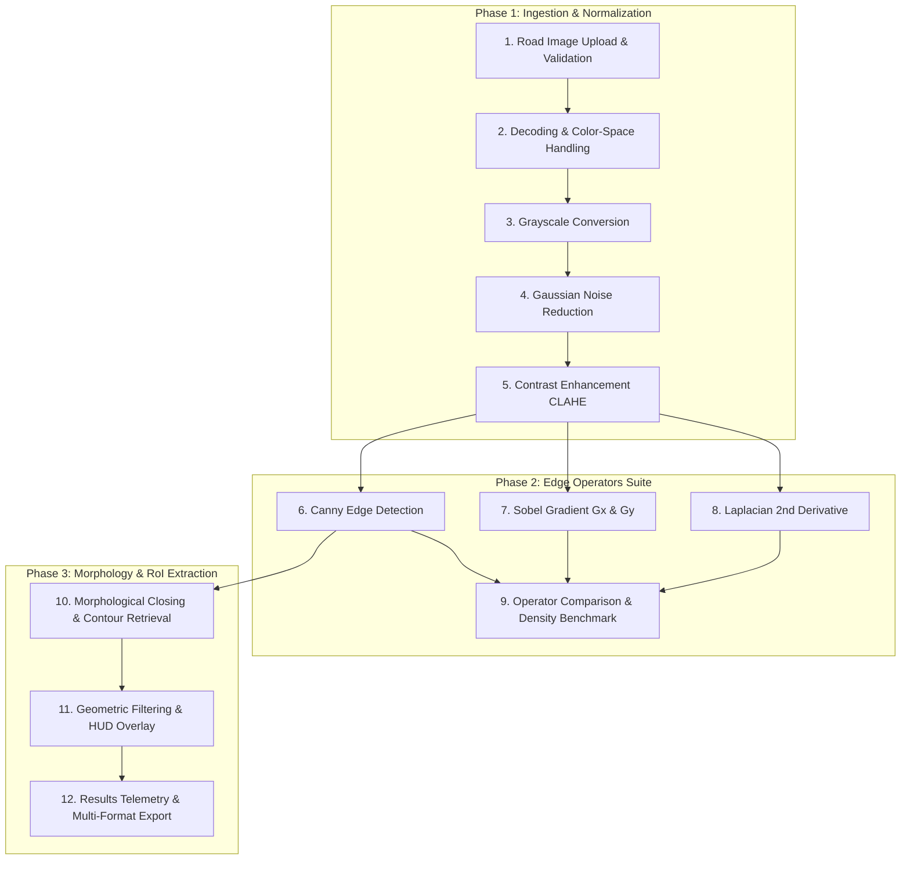

# METHODOLOGY & COMPUTER VISION PIPELINE

## PROJECT: Apply Edge Enhancement Techniques to Highlight Potholes in Road Images
**System Name:** POTHOLE AI — Road Surface Intelligence  
**Core Frameworks:** OpenCV, NumPy, Python 3.10+, Streamlit, Matplotlib  

---

## 1. PIPELINE OVERVIEW & ARCHITECTURE

The POTHOLE AI pipeline executes a sequential 12-step classical computer vision workflow designed to transform unstructured road surface images into calibrated edge maps, candidate defect hypotheses, and exportable engineering reports.

---

## 2. DETAILED 12-STEP IMAGE PROCESSING PIPELINE

### STEP 1: Road Image Upload & Validation
* **Purpose**: Verify that the incoming file is readable, uncorrupted, and possesses dimensions within safe physical processing thresholds.
* **Input**: Uploaded file buffer (raw bytes), PIL `Image` object, or NumPy array.
* **Output**: Boolean validation status (`is_valid: bool`), diagnostic message (`msg: str`), and validated RGB array (`rgb_numpy_array`).
* **Parameters & Boundaries**:
  * Minimum Dimensions: $16 \times 16$ px (prevents convolution kernel underflow).
  * Maximum Dimensions: $8192 \times 8192$ px (prevents CPU out-of-memory exhaustion).
  * Supported File Formats: `PNG`, `JPG`, `JPEG`, `WEBP`.
* **Failure Handling**: Corrupted headers or non-image files are caught gracefully, returning a descriptive error without crashing the application.

---

### STEP 2: Image Decoding & Color-Space Handling
* **Purpose**: Decode raw file bytes into an uncompressed array and normalize color channels.
* **Input**: Raw byte buffer from web upload or disk storage.
* **Output**: Standard 3-channel 8-bit unsigned integer RGB array (`shape: (H, W, 3), dtype: uint8`).
* **Implementation Details**:
  * Decoded using `cv2.imdecode(nparr, cv2.IMREAD_UNCHANGED)`.
  * **2D Grayscale**: If single-channel (`len(shape) == 2`), converted via `cv2.cvtColor(decoded, cv2.COLOR_GRAY2RGB)`.
  * **4-Channel RGBA**: If alpha channel is present, converted via `cv2.cvtColor(decoded, cv2.COLOR_BGRA2RGB)`.
  * **3-Channel BGR**: Standard OpenCV BGR captures are swapped to RGB format via `cv2.cvtColor(decoded, cv2.COLOR_BGR2RGB)`.

---

### STEP 3: Grayscale Conversion
* **Purpose**: Eliminate chromatic variance and reduce dimensionality from 3 color channels to a single 8-bit luminance intensity plane.
* **Input**: 3-channel RGB image ($H \times W \times 3$).
* **Output**: Single-channel grayscale image ($H \times W \times 1$, values $0–255$).
* **Methods Available**:
  1. **Weighted Luminance (ITU-R BT.601 standard)**:
     $$I_{\text{gray}} = 0.299 R + 0.587 G + 0.114 B$$
  2. **Unweighted Average**:
     $$I_{\text{gray}} = \frac{R + G + B}{3}$$
  3. **Green Channel Extraction**: Uses the green channel directly ($I_{\text{gray}} = G$), which offers maximum luminance clarity on asphalt textures.

---

### STEP 4: Gaussian Noise Reduction
* **Purpose**: Attenuate high-frequency asphalt aggregate noise (coarse gravel stones, bitumen roughness) to prevent false micro-edge responses during differentiation.
* **Input**: Grayscale image ($H \times W$).
* **Output**: Smooth grayscale image ($H \times W$).
* **Mathematical Formulation**:
  Convolves the image with a 2D Gaussian distribution kernel:
  $$G_\sigma(x, y) = \frac{1}{2\pi\sigma^2} \exp\left(-\frac{x^2+y^2}{2\sigma^2}\right)$$
* **Parameters**:
  * `kernel_size`: $k \in \{3, 5, 7\}$ (enforced as an odd integer $\ge 1$; even inputs automatically advance by $+1$).
  * `sigma` ($\sigma$): Standard deviation (default: $1.2$, valid range: $0.1–5.0$).

---

### STEP 5: Contrast Enhancement: CLAHE vs. Global Equalization
* **Purpose**: Normalize dynamic range under uneven road illumination (e.g., strong tree shadows or harsh direct midday sunlight).
* **Input**: Smoothed grayscale image.
* **Output**: Normalized contrast-enhanced grayscale image.
* **Techniques Implemented**:
  1. **CLAHE (Contrast Limited Adaptive Histogram Equalization - Recommended)**:
     * Partitions the image into contextual rectangular tiles ($8 \times 8$).
     * Clips local histograms at a predefined clip limit threshold ($\beta = 2.5$) to prevent over-amplifying noise in uniform asphalt.
     * Redistributes clipped pixels and combines tile boundaries via bilinear interpolation.
  2. **Global Histogram Equalization**:
     * Stretches the cumulative distribution function (CDF) across the global dynamic range $0–255$.
  3. **Linear Percentile Contrast Stretching**:
     * Clips the lower 2nd and upper 98th percentiles and rescales linearly.

---

### STEP 6: Canny Edge Detection (Optimal Boundary Localization)
* **Purpose**: Trace precise, single-pixel thin boundary contours of physical road cavities.
* **Input**: Contrast-enhanced smoothed grayscale image.
* **Output**: Binary edge map ($0$ or $255$).
* **Mathematical Steps**:
  1. **Spatial Gradient Calculation**: Derives directional gradients $G_x$ and $G_y$ using Sobel kernels.
  2. **Gradient Magnitude & Angle**:
     $$|\nabla I| = \sqrt{G_x^2 + G_y^2}, \quad \theta = \arctan\left(\frac{G_y}{G_x}\right)$$
  3. **Non-Maximum Suppression (NMS)**: Suppresses non-peak gradients along gradient vectors to thin broad ridges into single-pixel lines.
  4. **Dual Hysteresis Thresholding**:
     * Edge points $> T_{\text{high}}$ are classified as strong edges.
     * Edge points between $T_{\text{low}}$ and $T_{\text{high}}$ are retained only if 8-connected to strong edge points.
     * Points $< T_{\text{low}}$ are discarded.
* **Parameters**:
  * `low_threshold`: $T_{\text{low}}$ (default: $50$, range: $0–255$).
  * `high_threshold`: $T_{\text{high}}$ (default: $150$, range: $0–255$).
  * **Auto-Sort Fail-Safe**: If user provides $T_{\text{low}} > T_{\text{high}}$, the system automatically swaps them (`low, high = min(t1, t2), max(t1, t2)`).

---

### STEP 7: Sobel Gradient Detection (First-Order Directional Derivatives)
* **Purpose**: Evaluate orthogonal directional gradient components ($G_x$ and $G_y$) to inspect longitudinal versus transverse crack veins.
* **Input**: Contrast-enhanced smoothed grayscale image.
* **Output**: Continuous gradient magnitude map, binary edge map, and directional maps ($G_x, G_y$).
* **Kernels Applied**:
  $$K_x = \begin{bmatrix} -1 & 0 & +1 \\ -2 & 0 & +2 \\ -1 & 0 & +1 \end{bmatrix}, \quad K_y = \begin{bmatrix} -1 & -2 & -1 \\ 0 & 0 & 0 \\ +1 & +2 & +1 \end{bmatrix}$$
* **Parameters**:
  * `ksize`: Aperture size ($1, 3, 5, 7$; defaults to $3$).
  * `threshold`: Binary cutoff threshold (default: $80$, range: $0–255$).
* **Directional Breakdown**:
  * $G_x = |I * K_x|$ highlights vertical distress edges.
  * $G_y = |I * K_y|$ highlights horizontal distress edges.
  * Magnitude $G = \sqrt{G_x^2 + G_y^2}$ combines orthogonal responses.

---

### STEP 8: Laplacian Edge Detection (Second-Order Isotropic Derivative)
* **Purpose**: Detect zero-crossing inflection points corresponding to rapid concave depression boundaries.
* **Input**: Contrast-enhanced smoothed grayscale image.
* **Output**: Continuous Laplacian response and binary zero-crossing edge map.
* **Mathematical Formulation**:
  $$\nabla^2 f = \frac{\partial^2 f}{\partial x^2} + \frac{\partial^2 f}{\partial y^2}$$
* **Discrete Kernel ($3 \times 3$)**:
  $$K_L = \begin{bmatrix} 0 & 1 & 0 \\ 1 & -4 & 1 \\ 0 & 1 & 0 \end{bmatrix}$$
* **Parameters**:
  * `ksize`: Second-derivative aperture size ($1, 3, 5, 7$; defaults to $3$).
  * `threshold`: Binary threshold (default: $40$).

---

### STEP 9: Combining & Benchmarking Edge Maps
* **Purpose**: Quantitatively benchmark the performance, latency, and edge density of all three operators on the same pavement frame.
* **Metrics Calculated**:
  * **Execution Latency ($T_{\text{op}}$)**: Precise wall-clock duration in milliseconds using `time.perf_counter()`.
  * **Edge Pixel Density ($D_{\text{edge}}$)**: Percentage of non-zero edge pixels in the binary edge map:
    $$D_{\text{edge}} = \left(\frac{\sum_{x, y} \mathbb{I}(E(x, y) > 0)}{H \times W}\right) \times 100\%$$
* **Comparison Matrix**:
  * Canny: Cleanest localization, lowest false edge density (~$4–6\%$).
  * Sobel: Thicker gradient bands, higher edge density (~$7–12\%$).
  * Laplacian: Second-order double lines, highly sensitive to texture noise (~$6–11\%$).

---

### STEP 10: Morphological Closing & Contour Retrieval
* **Purpose**: Bridge fragmented edge discontinuities caused by uneven road erosion and retrieve closed geometric boundaries.
* **Input**: Binary edge map from primary detector (typically Canny).
* **Output**: Closed binary boundary map and list of hierarchical contours.
* **Mathematical Operation**:
  An elliptical structuring element $B_{k \times k}$ ($k=5$ or $7$) performs dilation followed by erosion (morphological closing):
  $$I_{\text{closed}} = (I_{\text{edge}} \oplus B) \ominus B$$
* **Contour Extraction**:
  Topological border following via Suzuki's algorithm (`cv2.findContours(cv2.RETR_EXTERNAL, cv2.CHAIN_APPROX_SIMPLE)`).

---

### STEP 11: Geometric Filtering & HUD Overlay Visualization
* **Purpose**: Filter out non-cavity noise (lane markings, construction joints, gravel speckles) and render an annotated visual overlay.
* **Input**: Extracted raw contours and original RGB image.
* **Output**: Filtered candidate list with metadata and annotated RGB overlay.
* **Filtering Criteria**:
  1. **Area Bounds**: $A_{\min} \le \text{Area}(C_i) \le A_{\max}$ (default: $200 \le A \le 80,000$ px).
  2. **Aspect Ratio**: $0.25 \le \frac{w}{h} \le 4.0$ (rejects linear lane stripes).
  3. **Solidity**: $\frac{\text{Area}(C_i)}{\text{Area}(\text{ConvexHull}(C_i))} \ge 0.35$ (rejects chaotic filaments).
  4. **Horizon Exclusion**: Top $15–30\%$ of the image is excluded from candidate extraction.
* **Candidate Saliency Scoring**:
  $$S = S_{\text{size}} + S_{\text{solidity}} + S_{\text{contrast}} \in [15, 99]$$
* **Overlay Rendering**:
  Draws green bounding boxes (`#32D6A0`), semi-transparent fills ($\alpha=0.15$), and candidate ID tags onto a copy of the RGB image.

---

### STEP 12: Results Display & Multi-Format Research Exports
* **Purpose**: Present telemetry on the dashboard and export reproducible research artifacts.
* **Outputs Generated**:
  1. **Processed Overlay Image (PNG)**: Full-resolution annotated inspection capture.
  2. **6-Stage Pipeline Montage (PNG)**: Side-by-side composite showing Input, CLAHE Enhanced, Canny, Sobel, Laplacian, and Overlay.
  3. **Standardized Research JSON Report**: Machine-readable JSON containing timestamp, image dimensions, full parameter dictionary, per-operator latencies, edge densities, and per-candidate bounding boxes/areas/solidity scores.
  4. **Session Audit Trail (CSV)**: Tabular audit log of all inspections performed during the session.

---

## 3. EDGE DETECTION VS. SEMANTIC CLASSIFICATION

A fundamental distinction must be maintained between classical edge detection and deep-learning semantic classification:

| Dimension | Classical Edge Detection (POTHOLE AI) | Deep Neural Network (YOLOv8 / Faster R-CNN) |
| :--- | :--- | :--- |
| **Detection Basis** | Deterministic mathematical luminance gradients ($\nabla I, \nabla^2 I$). | Learned statistical patterns from thousands of labeled ground-truth examples. |
| **Output Type** | **Distress Candidate Regions** (hypothesis proposals). | Predicted object classes with statistical probability. |
| **Interpretability** | **100% Explainable**: Driven by explicit thresholds, convolution matrices, and geometric constraints. | **Black-Box**: Millions of weights operating across latent feature spaces. |
| **Hardware Overhead** | Ultra-lightweight CPU execution (~49 ms per frame). | Requires dedicated GPU hardware (CUDA/TensorRT) for real-time inference. |
| **Sensitivity to Shadows** | Sensitive to tree shadows and pavement seams (require tuning). | Can learn to ignore shadows if present in training distribution. |
| **Operational Role** | **High-Recall Screening Proposer**: Flags regions for maintenance review. | **Classifier**: Confirms whether a proposed region is truly a pothole. |

> **Academic Caveat**: Candidate regions flagged by POTHOLE AI represent physical gradient anomalies on the pavement surface. They serve as automated screening alerts for municipal maintenance teams, not autonomous ground-truth labels.
