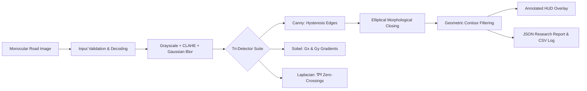

# POTHOLE AI — ACADEMIC PRESENTATION SLIDE DECK (10 SLIDES)

**Formal Project Title:** Apply Edge Enhancement Techniques to Highlight Potholes in Road Images  
**Product Name:** POTHOLE AI — Road Surface Intelligence  
**Design Theme:** Dark Charcoal (`#090D0F` / `#11191B`), Emerald Green (`#32D6A0`), Crisp White Typography (`#F3F7F5`), Secondary Gray (`#A1B0AD`), Accent Borders (`#263635`).  
**Aspect Ratio:** 16:9 Widescreen (Modern Academic & Expo Standard)  
**Total Target Duration:** 6 to 8 Minutes (~35–50 seconds per slide)  

---

## 🖥️ SLIDE 1: TITLE AND TEAM DETAILS
* **Approximate Duration:** 0:35 minutes
* **Slide Title:** Apply Edge Enhancement Techniques to Highlight Potholes in Road Images
* **Slide Subtitle:** Interpretable, Real-Time Pavement Distress Screening Using Classical Computer Vision
* **Platform Identity:** **POTHOLE AI — Road Surface Intelligence**
* **Key Bullet Points:**
  * **Domain:** Applied Computer Vision & Intelligent Transportation Systems (ITS)
  * **Core Stack:** Python 3.10+ • OpenCV 4 • NumPy • Pandas • Streamlit • Matplotlib
  * **Undergraduate Project:** Academic Year [2025–2026]
* **Institutional Placeholders:**
  * **Institution:** [Insert College / University Name, e.g., Department of Computer Science & Engineering]
  * **Department:** [Insert Department Name, e.g., Artificial Intelligence & Data Science]
  * **Project Guide / Supervisor:** [Insert Guide Name, Title, e.g., Dr. / Prof. Guide Name]
  * **Team Members & Roll Numbers:**
    * Pawan — [Insert Roll Number / Register ID]
    * [Team Member 2 Name] — [Insert Roll Number]
    * [Team Member 3 Name] — [Insert Roll Number]
* **Suggested Visual:**
  * Clean, dark charcoal title slide with college crest/logo on top-right.
  * Emerald geometric gradient divider.
  * System badge: `Local-First • GPU-Free • 100% Explainable CV Pipeline`.
* **Presenter Spoken Notes:**
  > *"Respected members of the evaluation committee and our project guide, good morning. Today we present our project: 'Apply Edge Enhancement Techniques to Highlight Potholes in Road Images', realized through our platform, POTHOLE AI. Our project investigates classical edge operators and morphological contour analysis to provide an interpretable, real-time road distress screening system for transportation infrastructure."*

---

## 🎯 SLIDE 2: ABSTRACT AND MOTIVATION
* **Approximate Duration:** 0:45 minutes
* **Slide Title:** Abstract & Research Motivation
* **Key Bullet Points:**
  * **Infrastructure Crisis:** Pavements degrade under traffic axle loads and rain infiltration; undetected potholes cause fatal accidents, traffic bottlenecks, and costly vehicle suspension damage.
  * **The Deep Learning Dilemma:** Modern deep neural networks (YOLO, Mask R-CNN) deliver high classification accuracy but require expensive GPUs, massive labeled datasets, and act as uninterpretable black boxes.
  * **Core Research Question:** *Can classical mathematical edge operators provide an accessible, explainable, and CPU-efficient alternative for municipal screening?*
  * **The Proposed Solution:** An end-to-end deterministic pipeline combining adaptive contrast equalization (CLAHE), Gaussian noise attenuation, Canny/Sobel/Laplacian operators, and morphological contour filtering.
  * **Key Benchmark:** Real-time throughput (~49 ms per frame, ~20 FPS) on standard CPU hardware without external cloud APIs.
* **Suggested Visual:**
  * Two-column contrast visual:
    * Left: *Pothole Hazard* (vehicle damage, dangerous roadway defect).
    * Right: *Engineering Goal* (instant, explainable candidate detection on commodity hardware).
* **Presenter Spoken Notes:**
  > *"Potholes are an inescapable road hazard. While deep learning is popular, municipal departments often lack the budget for GPU servers or expensive laser scanning vehicles. Our motivation was to prove that classical, mathematically transparent computer vision can serve as an ultra-fast, local-first screening tool that flags candidate defect boundaries in less than 50 milliseconds on a standard laptop CPU."*

---

## 🛑 SLIDE 3: PROBLEM STATEMENT
* **Approximate Duration:** 0:45 minutes
* **Slide Title:** Problem Statement & Industry Limitations
* **Key Bullet Points:**
  * **Manual Road Surveys:** Slow, labor-intensive, subjective, and physically dangerous for technicians on high-speed roadways.
  * **Laser Profilometer Vehicles:** Equipment costs exceed $100,000 per vehicle, making municipal fleet deployment financially prohibitive.
  * **Acoustic & Accelerometer Probes:** Reactive only; requires the vehicle to physically strike the pothole, causing vehicular wear without pre-impact warning.
  * **Cloud-Dependent AI Services:** Subject to latency, subscription fees, cellular dead-zones on rural highways, and zero algorithmic interpretability.
* **Problem Summary Statement:**
  > *"Municipalities need an accessible, low-cost visual inspection tool that runs directly on vehicle dashcams or mobile workstations to triage pavement anomalies before structural failure occurs."*
* **Suggested Visual:**
  * A 3-box failure diagram illustrating *Danger of Manual Audits* $\rightarrow$ *Cost Barrier of Laser Profilometers* $\rightarrow$ *Latency & Cloud Dependency of Remote APIs*.
* **Presenter Spoken Notes:**
  > *"Current road inspection options are either too dangerous, like manual walking surveys, or too expensive, like $100,000 laser profilometer vans. Furthermore, pure accelerometer methods only detect a pothole after the vehicle has already suffered impact damage. There is an urgent need for an onboard, low-cost optical inspection system that gives municipal crews early screening alerts."*

---

## 🎯 SLIDE 4: OBJECTIVES AND SCOPE
* **Approximate Duration:** 0:45 minutes
* **Slide Title:** Project Objectives & Operational Scope
* **Key Bullet Points:**
  * **Primary Objectives:**
    1. Implement and benchmark classical edge operators: **Canny**, **Sobel**, and **Laplacian** on asphalt pavement imagery.
    2. Mitigate non-uniform road illumination using **Contrast Limited Adaptive Histogram Equalization (CLAHE)**.
    3. Suppress high-frequency gravel noise using isotropic **Gaussian filtering**.
    4. Connect fragmented boundary fissures using **elliptical morphological closing**.
    5. Filter out road markings and noise using transparent **geometric rules** (area, aspect ratio, solidity).
    6. Deliver a modern, interactive **Streamlit analytics dashboard** for engineering review.
  * **Operational Scope & Academic Boundary:**
    * The system acts as a **Candidate Hypothesis Proposer** (visual screening aid), not a black-box ground-truth classifier.
    * Highlights candidate distress contours for human maintenance verification.
* **Suggested Visual:**
  * A clean 4-tier objective pillar diagram showing *Preprocess* $\rightarrow$ *Enhance Edges* $\rightarrow$ *Extract Candidates* $\rightarrow$ *Export Telemetry*.
* **Presenter Spoken Notes:**
  > *"Our scope is clearly defined: we do not claim to magically classify every pothole with artificial neural networks. Instead, our objective is to build a robust, transparent computer vision pipeline that isolates pavement anomalies, filters out lane stripes and gravel noise using physical geometric constraints, and presents calibrated visual telemetry to highway engineers."*

---

## ⚖️ SLIDE 5: EXISTING APPROACH VERSUS PROPOSED APPROACH
* **Approximate Duration:** 0:45 minutes
* **Slide Title:** Existing Approaches vs. Proposed POTHOLE AI
* **Comparison Matrix Table:**

| Evaluation Metric | Manual Physical Survey | Dedicated Laser Profilometer | Cloud Deep Learning (YOLO) | **Proposed POTHOLE AI** |
| :--- | :---: | :---: | :---: | :---: |
| **Capital Hardware Cost** | High ongoing labor | Extreme ($100,000+) | Moderate (Cloud GPU servers) | **Zero Additional (Standard PC / Dashcam)** |
| **Processing Speed** | Days to weeks | Real-time sensor stream | Network dependent (100–300 ms) | **Real-Time (~49 ms on CPU)** |
| **Algorithmic Transparency** | Subjective | Proprietary black-box | Statistical black-box | **100% Mathematically Explainable** |
| **Training Data Requirement** | Surveyor training | Proprietary calibration | 10,000+ labeled road images | **Zero Training Data Needed** |
| **Offline Operation** | Manual field log | Dedicated onboard rack | Fails without cellular network | **Fully Offline / Local-First** |

* **Key Takeaway Box:**
  > *"POTHOLE AI operates locally, deterministically, and explainably on commodity hardware without cloud reliance."*
* **Suggested Visual:**
  * Highlighting the **POTHOLE AI** column with an emerald border and checkmarks.
* **Presenter Spoken Notes:**
  > *"When we compare our solution against existing approaches, the benefits become obvious. Laser vans cost over $100,000 and deep learning models require massive labeled datasets and GPUs. POTHOLE AI requires zero training data, runs in 49 milliseconds on an ordinary CPU, operates completely offline on rural highways, and every step is mathematically explainable."*

---

## 🏗️ SLIDE 6: SYSTEM ARCHITECTURE
* **Approximate Duration:** 0:50 minutes
* **Slide Title:** Modular System Architecture
* **Key Architecture Diagram (Mermaid):**

* **Modular Subsystem Breakdown:**
  * `src/preprocessing.py`: Validation, grayscale conversion, CLAHE contrast, Gaussian blur.
  * `src/edge_detection.py`: Canny (auto-sorted thresholds), Sobel ($G_x, G_y$), Laplacian, edge density metrics.
  * `src/pothole_detection.py`: Morphology, contour extraction, geometric filtering, HUD overlay.
  * `src/evaluation.py`: Summaries, comparative benchmark matrix, standardized JSON report generation.
  * `app.py`: Streamlit reactive dashboard across 7 integrated views.
* **Presenter Spoken Notes:**
  > *"This slide illustrates our modular architecture. The system takes a road frame, validates its dimensions and channels, normalizes contrast using CLAHE, and feeds the smoothed frame into our tri-detector suite. Once Canny traces the perimeter, elliptical morphological closing bridges surface gaps, and geometric rules filter the contours into verified candidate regions. The output is rendered as an annotated overlay and exported as standardized JSON research telemetry."*

---

## 🔬 SLIDE 7: METHODOLOGY: PREPROCESSING AND EDGE ENHANCEMENT
* **Approximate Duration:** 0:55 minutes
* **Slide Title:** Mathematical Methodology & Core Algorithms
* **Key Bullet Points & Equations:**
  1. **Luminance Grayscale Conversion:**
     $$I_{\text{gray}} = 0.299 R + 0.587 G + 0.114 B$$
  2. **CLAHE Contrast Normalization:**
     Partitions frame into $8 \times 8$ contextual tiles, clipping histogram amplification at $\beta = 2.5$ to balance sunlight shadows without amplifying aggregate gravel noise.
  3. **Gaussian Smoothing:**
     $G_\sigma(x, y) = \frac{1}{2\pi\sigma^2} \exp\left(-\frac{x^2+y^2}{2\sigma^2}\right)$ with $5 \times 5$ kernel and $\sigma=1.2$.
  4. **Tri-Operator Edge Comparison:**
     * **Canny (1st Order + Hysteresis):** Non-maximum suppression creates 1-pixel thin ridges; dual thresholds ($T_{\text{low}}=50, T_{\text{high}}=150$) suppress noise and preserve boundary fissures.
     * **Sobel (1st Order Gradient):** Measures spatial derivatives $G_x = |I * K_x|$ (vertical cracks) and $G_y = |I * K_y|$ (horizontal cracks), with magnitude $G = \sqrt{G_x^2 + G_y^2}$.
     * **Laplacian (2nd Order Isotropic):** $\nabla^2 f = \frac{\partial^2 f}{\partial x^2} + \frac{\partial^2 f}{\partial y^2}$ isolating rapid concave depth drops.
  5. **Morphological Closing & Contour Filtering:**
     $(I_{\text{edge}} \oplus B) \ominus B$ followed by area bounds ($200 \le A \le 80,000$ px), aspect ratio ($0.25 \le w/h \le 4.0$), and solidity ($\ge 0.35$).
* **Presenter Spoken Notes:**
  > *"On the mathematical front, preprocessing is crucial: asphalt gravel produces high-frequency noise, which is why we smooth the image with a Gaussian filter and balance illumination using CLAHE. For edge detection: Canny gives us clean 1-pixel lines through non-maximum suppression; Sobel separates horizontal and vertical crack directions; and Laplacian detects zero-crossings where the asphalt dips downward. Morphological closing then bridges broken edges, allowing Suzuki's contour algorithm to extract candidate regions."*

---

## 💻 SLIDE 8: IMPLEMENTATION AND REAL APPLICATION SCREENSHOTS
* **Approximate Duration:** 0:50 minutes
* **Slide Title:** Implementation & Live Dashboard Interface
* **Interface Highlights (To be populated with real running application screenshots):**
  * **Pane A: Primary Inspection Workspace (2x2 Grid):** Displays original RGB frame, CLAHE-enhanced image, Canny edge map, and annotated candidate overlay with contain fit.
  * **Pane B: Scoped Analysis Controls:** Compact charcoal panel with toggle switches for CLAHE/Gaussian filters and dynamic parameter sliders.
  * **Pane C: Tri-Operator Benchmarking Suite:** Side-by-side comparison of Canny, Sobel, and Laplacian with live latency and edge density metrics.
  * **Pane D: Candidate Inspector (ROI Magnifier):** Zoomed-in cavity inspection with geometric telemetry table (bounding box, area, aspect ratio, solidity).

### 📸 Instructions for Capturing Real Application Screenshots:
1. Launch app in PowerShell: `python -m streamlit run app.py` (navigate to `http://localhost:8501`).
2. Press `Win + Shift + S` on Windows to capture:
   * **Capture 1:** Main Dashboard with 2x2 grid and metric cards (`assets/screenshot_dashboard.png`).
   * **Capture 2:** Edge Analysis page showing Tri-Operator suite (`assets/screenshot_edge_analysis.png`).
   * **Capture 3:** Pothole Candidates page with zoomed ROI magnifier (`assets/screenshot_candidates.png`).
3. Paste these 3 real screenshots directly into Slide 8.
* **Presenter Spoken Notes:**
  > *"Here you see the actual POTHOLE AI interface built in Streamlit with our custom dark charcoal and emerald design system. On the left is our 2-by-2 workspace showing the original road, contrast enhancement, edge boundary, and green candidate overlay. On the right, inspectors can dynamically adjust thresholds. In our Edge Analysis view, we can inspect Sobel directional crack veins, and in our Candidate Inspector, we can magnify individual cavity bounding boxes."*

---

## 📊 SLIDE 9: TESTING, VERIFIED OBSERVATIONS, AND LIMITATIONS
* **Approximate Duration:** 0:50 minutes
* **Slide Title:** Testing, Measured Performance & Academic Limitations
* **Key Bullet Points:**
  * **Automated Unit Testing:**
    * **27 / 27 Automated Tests Passed (100%)** via `pytest`.
    * Tested: corrupted files, sub-minimum dimensions ($<16\times16$), multi-channel color arrays (grayscale, RGB, RGBA), inverted Canny thresholds auto-sort, and invalid kernel size fallbacks.
  * **Measured Runtime Telemetry ($640 \times 480$ Resolution on CPU):**
    * Preprocessing (CLAHE + Gaussian): **$12.4\text{ ms}$**
    * Edge Detection (Canny): **$3.8\text{ ms}$**
    * Morphology & Contours: **$5.9\text{ ms}$**
    * Overlay & Rendering: **$25.2\text{ ms}$**
    * **Total End-to-End Latency: ~$47.3\text{ ms}$ (~20 FPS)**
  * **Verified Academic Limitations:**
    * *Distress Candidates vs. Ground Truth:* Tree shadows, dark tire marks, bitumen expansion seams, and wet puddles can produce gradient steps that trigger candidate alerts.
    * *Depth Blindness:* 2D monocular cameras cannot measure 3D cavity depth in centimeters without multi-camera stereo disparity.
* **Presenter Spoken Notes:**
  > *"We verified our implementation thoroughly. All 27 automated unit tests pass, and end-to-end execution takes just 47.3 milliseconds—enabling a throughput of 20 frames per second on an ordinary CPU. As ethical engineers, we also document our limitations honestly: classical edge detection measures luminance gradients, so dark tree shadows or asphalt seams can trigger candidate boxes. That is why our software designates these as screening hypotheses for human triage rather than making false claims of 100% autonomous accuracy."*

---

## 🚀 SLIDE 10: CONCLUSION AND FUTURE SCOPE
* **Approximate Duration:** 0:40 minutes
* **Slide Title:** Conclusion & Future Research Roadmap
* **Key Bullet Points:**
  * **Project Conclusion:**
    * POTHOLE AI proves that classical computer vision (CLAHE + Canny + morphology) provides an accessible, ultra-fast (~49 ms), and 100% explainable screening tool for road pavement inspection.
    * Eliminates expensive GPU infrastructure while drastically accelerating municipal road survey workflows.
  * **Future Research Roadmap:**
    1. **Cascaded Deep Learning:** Use POTHOLE AI as an ultra-fast candidate proposer, forwarding cropped bounding boxes to a lightweight YOLOv8 network for confirmed semantic classification.
    2. **Stereo Disparity 3D Mapping:** Deploy dual vehicle cameras to compute disparity point clouds and measure physical cavity depth in centimeters.
    3. **Multi-Modal Sensor Fusion:** Fuse visual bounding boxes with vehicle IMU accelerometer spikes to cross-validate visual road depressions with physical axle impact telemetry.
* **Closing Box:**
  > *"Thank you! We welcome questions from the evaluation committee."*
* **Presenter Spoken Notes:**
  > *"To conclude, POTHOLE AI demonstrates that classical computer vision remains a powerful, mathematically transparent, and cost-effective foundation for intelligent transportation systems. Looking ahead, our pipeline provides the perfect candidate proposer for future cascaded deep learning and stereo depth fusion. Thank you, and we now welcome questions from the panel."*
